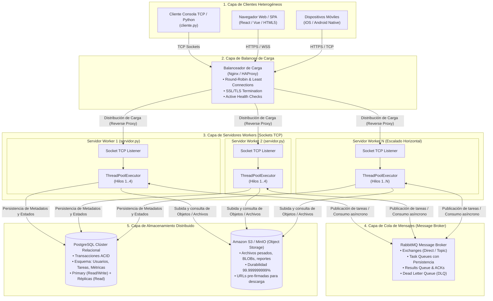

# PFO 3: Rediseño como Sistema Distribuido (Cliente-Servidor)

**Materia:** Programación sobre Redes  
**Carrera:** Tecnicatura Superior en Desarrollo de Software (TSDS)  
**Alumno:** Guillermo Aybar  
**Año lectivo:** 2026  

---

## 🎯 Objetivos del Trabajo Práctico

1. **Diseñar una arquitectura distribuida completa y escalable**, integrando clientes heterogéneos, balanceador de carga, servidores workers con pool de hilos, broker de mensajería (RabbitMQ) y capas de almacenamiento distribuido (PostgreSQL y S3).
2. **Implementar en Python un servidor de red basado en sockets TCP** capaz de aceptar múltiples conexiones concurrentes y distribuir el cómputo de tareas hacia un **Pool de Workers multihilo** (`ThreadPoolExecutor`).
3. **Implementar en Python un cliente de red por sockets** que envíe tareas estructuradas, gestione la recepción de resultados y aplique **políticas de reintentos y tolerancia a fallos** (conforme a los conceptos vistos en la Clase 10).
4. **Validar la concurrencia y distribución del trabajo** mediante pruebas automatizadas con múltiples clientes paralelos en contienda.
5. **Generar la documentación técnica y diagramas de arquitectura** para su entrega y publicación en GitHub.

---

## 📐 Consigna 1: Arquitectura del Sistema Distribuido

### 1.1 Diagrama del Sistema

El siguiente diagrama modela el flujo integral de datos y la separación por capas de la arquitectura distribuida diseñada:



> [!NOTE]
> Además del diagrama Mermaid anterior, se incluye el archivo vectorial de alta definición **[`diagrama_arquitectura.svg`](diagrama_arquitectura.svg)** en el repositorio, apto para visualización en navegadores y exportación a documentos formales.

---

### 1.2 Análisis Detallado de los Componentes Requeridos

#### 1. Clientes (Móviles, Web, CLI)
* **Heterogeneidad de Plataformas:** Los clientes representan el punto de interacción final del usuario. Se componen de:
  - **Clientes Web (SPA):** Navegadores que ejecutan aplicaciones modernas (React, Vue, TypeScript) comunicándose mediante WebSockets o REST/HTTP.
  - **Clientes Móviles:** Aplicaciones nativas de iOS y Android que requieren optimización en consumo de batería y tolerancia a pérdida de cobertura de red.
  - **Clientes de Consola / Terminal (CLI):** Scripts automatizados o utilitarios técnicos desarrollados en Python (`cliente.py`) que abren conexiones de socket TCP puras.
* **Desacoplamiento Total:** Ningún cliente conoce la dirección IP interna ni la infraestructura de base de datos o almacenamiento. Su único contacto es el balanceador de carga o socket público.

#### 2. Balanceador de Carga (Nginx / HAProxy)
* **Punto Único de Entrada (*Single Point of Entry*):** Recibe todas las peticiones entrantes desde los clientes y las distribuye equilibradamente entre la granja de servidores de procesamiento.
* **Algoritmos de Balanceo Soportados:**
  - *Round-Robin:* Distribución secuencial uniforme entre todos los nodos activos.
  - *Least Connections:* Enrutamiento de la nueva petición al servidor con menor número de sockets o conexiones TCP activas en ese instante (ideal para tareas de duración variable).
  - *IP Hash:* Útil cuando se necesita persistencia de afinidad de sesión con un servidor determinado.
* **Terminación SSL/TLS:** Descomprime y desencripta el tráfico seguro HTTPS/WSS a nivel del balanceador, aliviando la carga de cómputo en los servidores workers internos.
* **Comprobación de Salud Activa (*Health Checks*):** Envía señales de ping periódicas a cada servidor worker; si un nodo sufre una caída de red o colapso, el balanceador lo retira automáticamente del pool en milisegundos, evitando errores en los clientes.

#### 3. Servidores Workers (con Pool de Hilos)
* **Arquitectura Multihilo (*Multithreaded Worker Pool*):** Implementada en Python mediante la biblioteca `concurrent.futures.ThreadPoolExecutor`.
* **Desacoplamiento Socket-Ejecución:** El hilo principal del servidor socket (`accept()`) nunca procesa tareas pesadas de forma sincrónica. Cuando un cliente transmite una tarea, el servidor la empaqueta y la despacha al pool de hilos de trabajo.
* **Concurrencia Eficiente:** Permite atender decenas de clientes de forma simultánea. Mientras un hilo worker espera operaciones de entrada/salida (I/O) hacia la base de datos o almacenamiento S3, otros hilos workers procesan cálculos de CPU intensivos (cálculo de números primos, hashing SHA-256, análisis de texto).
* **Escalabilidad Horizontal:** Se pueden desplegar múltiples réplicas del contenedor/proceso de workers en diferentes máquinas físicas o instancias de clúster.

#### 4. Cola de Mensajes (RabbitMQ)
* **Protocolo Estándar AMQP (Advanced Message Queuing Protocol):** Actúa como el intermediario inteligente de mensajería (*message broker*) entre servidores y servicios desacoplados.
* **Exchanges y Routing Keys:** Permite clasificar y distribuir los mensajes hacia colas dedicadas según la prioridad o tipo de tarea (por ejemplo: `tareas.cpu`, `tareas.reportes`, `tareas.criticas`).
* **Regulación de Tráfico (*Backpressure* y Buffer):** En caso de un pico abrupto de miles de peticiones simultáneas, las tareas no desbordan ni colapsan la memoria de los servidores workers; en su lugar, se encolan de forma persistente en RabbitMQ y los workers las van consumiendo a su propio ritmo de procesamiento.
* **Confirmaciones de Entrega (*ACKs*) y Dead Letter Queues (DLQ):** Un mensaje no es eliminado de la cola hasta que el worker confirma (`ack`) su procesamiento exitoso. Si un worker muere en medio de una tarea, RabbitMQ reasigna inmediatamente el mensaje a otro worker disponible. Las tareas fallidas repetidamente se desvían a una DLQ para auditoría.

#### 5. Almacenamiento Distribuido (PostgreSQL y S3)
* **PostgreSQL (Capa Relacional Transaccional ACID):**
  - Almacena datos fuertemente estructurados: usuarios, permisos, logs de auditoría, estados de tareas (`PENDING`, `IN_PROGRESS`, `COMPLETED`, `FAILED`), métricas de tiempo y claves foráneas.
  - Arquitectura distribuida con nodo **Primary** para escrituras atómicas y múltiples **Réplicas de Lectura** (*Read Replicas*) para distribuir consultas de alta demanda.
  - Implementación de pool de conexiones (como PgBouncer) para evitar la sobrecarga de conexiones TCP directas a la base de datos.
* **Amazon S3 / MinIO (Almacenamiento de Objetos / BLOBs):**
  - Especializado en almacenar archivos binarios no estructurados de gran tamaño (imágenes, adjuntos de tareas, volcados de bases de datos, archivos `.csv` procesados).
  - Durabilidad del 99.999999999% (*eleven nines*) y replicación multi-zona de disponibilidad (Multi-AZ).
  - Uso de **URLs pre-firmadas (*Pre-signed URLs*):** Permite que un cliente suba o descargue un archivo pesado directamente hacia/desde S3 con tokens de seguridad temporales, sin sobrecargar la memoria ni el ancho de banda de los servidores de sockets.

---

## 💻 Consigna 2: Implementación en Python

La solución práctica fue desarrollada en Python garantizando portabilidad inmediata mediante la **Biblioteca Estándar**, libre de dependencias externas complejas.

### 2.1 Servidor Sockets Distribuido (`servidor.py`)

El servidor implementa las siguientes características clave de redes y concurrencia:
1. **Configuración Robusta del Socket TCP:**
   - Familia `socket.AF_INET` y transporte confiable `socket.SOCK_STREAM`.
   - Opción `SO_REUSEADDR` activada para permitir reiniciar el servidor inmediatamente sin esperar el estado `TIME_WAIT` del kernel.
2. **Pool de Hilos de Workers (`ThreadPoolExecutor`):**
   - Configurable mediante `MAX_WORKERS` (por defecto 4 hilos de cómputo paralelos).
   - El hilo receptor del cliente despacha tareas al pool mediante `pool_workers.submit(ejecutar_tarea_worker, tarea_info)` obteniendo un `Future`.
3. **Protocolo de Aplicación sobre TCP:**
   - Tramas estructuradas en formato JSON delimitadas por el carácter de nueva línea (`\n`). Esto elimina por completo el riesgo de fragmentación o adhesión de mensajes (*stream sticking / packet concatenation*) inherente a los flujos TCP continuos.
4. **Catálogo de Tareas Soportadas:**
   - `calculo_primos`: Cómputo matemático intensivo en CPU para evaluar el rendimiento de hilos.
   - `hash_criptografico`: Ejecución de 50.000+ rondas iterativas de SHA-256 con Salt (*Key Stretching*).
   - `procesamiento_texto`: Conteo de palabras, caracteres y extracción de frecuencias de vocabulario.
   - `almacenamiento_s3`: Simulación del pipeline de persistencia distribuida generando URIs S3 y IDs transaccionales PostgreSQL.
   - `estado`: Consulta de métricas globales en memoria (clientes activos, históricos, tareas completadas, tareas fallidas) sincronizadas con cerrojos de exclusión mutua (`threading.Lock`).
5. **Apagado Ordenado (*Graceful Shutdown*):**
   - Captura la señal `SIGINT` / `KeyboardInterrupt` (`Ctrl+C`), cierra el socket pasivo y espera la finalización de los hilos de trabajo mediante `pool_workers.shutdown(wait=True)`.

### 2.2 Cliente Sockets con Tolerancia a Fallos (`cliente.py`)

Siguiendo los lineamientos de la **Clase 10 (Manejo de Errores y Flujo de Datos en Sockets)**, el cliente implementa:
1. **Conexión con Política de Reintentos:**
   - Función `conectar_con_reintentos(host, puerto, max_intentos=4, espera=2)`.
   - Si el servidor se encuentra temporalmente ocupado o iniciando, el cliente no colapsa: espera un intervalo y reintenta de forma automática antes de abortar.
2. **Medición de Latencia de Red:**
   - Cronometraje de alta precisión (`time.perf_counter()`) calculando el tiempo total de ida y vuelta (*Round Trip Time - RTT*), diferenciando la latencia de red del tiempo de cómputo reportado por el worker.
3. **Interfaz Interactiva de Usuario:**
   - Menú en consola numerado del 1 al 7 que permite ingresar parámetros personalizados para cada tipo de tarea.
4. **Modo Automatizado (`--auto` / `--test`):**
   - Permite ejecutar lotes completos de pruebas sin intervención manual, facilitando la integración continua y validación rápida.

### 2.3 Script de Pruebas de Estrés y Concurrencia (`test_distribuido.py`)

Para demostrar el comportamiento del sistema distribuido bajo carga real:
- Dispara **8 clientes concurrentes en hilos independientes de forma paralela**.
- Cada cliente establece una conexión TCP simultánea con el servidor y envía tareas de diversa naturaleza.
- Verifica que las peticiones sean consumidas por **distintos hilos workers** (`WorkerThread_0`, `WorkerThread_1`, `WorkerThread_2`, etc.) en paralelo, finalizando la batería en una fracción de segundo sin bloqueos.

---

## 📊 Comparativa: De la Arquitectura Monolítica a la Distribuida

| Criterio | PFO 1 (Chat TCP Básico) | PFO 2 (API REST Monoproceso) | PFO 3 (Sistema Distribuido) |
|---|---|---|---|
| **Protocolo de Comunicación** | Socket TCP texto plano | HTTP / REST con Flask | Sockets TCP con tramas JSON delimitadas |
| **Modelo de Concurrencia** | Bucle secuencial monohilo | Monoproceso WSGI de desarrollo | **Multihilo con ThreadPoolExecutor** |
| **Distribución de Tareas** | Inexistente (bloqueante) | Inexistente (monohilo) | **Delegación asíncrona a clúster de workers** |
| **Balanceo de Carga** | Ninguno | Ninguno | **Nginx / HAProxy (Round-Robin, Health Checks)** |
| **Cola de Mensajería** | No posee | No posee | **RabbitMQ Broker (AMQP, ACKs, DLQ)** |
| **Capa de Persistencia** | SQLite local monousuario | SQLite local (`tareas.db`) | **PostgreSQL (ACID relacional) + AWS S3 (BLOBs)** |
| **Tolerancia a Fallos** | Cierre ante error | Captura básica de excepciones | **Reintentos de red, Backoff, Worker Recovery** |

---

## 🚀 Guía de Instalación y Ejecución

### Requisitos Previos
- Python 3.10 o superior instalado.
- Ninguna librería externa obligatoria (se utiliza la biblioteca estándar de Python).

### Paso 1: Iniciar el Servidor Distribuido
Abrir una terminal en el directorio `PFO3_Guillermo_Aybar`:
```bash
python servidor.py
```
*Salida esperada:*
```text
========================================================================
  PFO 3: SERVIDOR DISTRIBUIDO CON SOCKETS Y POOL DE WORKERS (TSDS)  
  Escuchando en: 127.0.0.1:65432
  Workers disponibles en el Pool de Hilos: 4
========================================================================
[+] [INICIO] Servidor iniciado exitosamente. Presione Ctrl+C para detener.
```

### Paso 2: Ejecutar el Cliente Interactivo
En una **segunda terminal**, dentro del mismo directorio:
```bash
python cliente.py
```
Se desplegará el menú interactivo para enviar tareas individuales o por lotes:
```text
=================================================================
  PFO 3: CLIENTE DE SISTEMA DISTRIBUIDO (SOCKETS TCP)            
  Alumno: Guillermo Aybar | TSDS 2026                            
=================================================================
  1. Enviar Tarea: Cálculo Matemático (Números Primos en Rango)
  2. Enviar Tarea: Criptografía Intensiva (Hashing con Salt)
  3. Enviar Tarea: Procesamiento y Análisis de Texto
  4. Enviar Tarea: Pipeline Distribuido (S3 + PostgreSQL)
  5. Consultar Métricas y Estado del Clúster / Servidor
  6. Enviar Lote de Demostración de Tareas Variadas
  7. Salir
=================================================================
Seleccione una opción (1-7):
```

### Paso 3: Ejecutar la Batería de Pruebas de Concurrencia
En una terminal adicional, ejecutar:
```bash
python test_distribuido.py
```
*Salida esperada:*
```text
===========================================================================
  BATERÍA DE PRUEBAS DE CONCURRENCIA DISTRIBUIDA (PFO 3)             
  Lanzando 8 clientes paralelos por socket TCP hacia 127.0.0.1:65432
===========================================================================

[+] Todos los clientes finalizaron sus peticiones.

CLIENTE    | TASK ID    | TIPO                   | WORKER             | ESTADO     | TIEMPO
-------------------------------------------------------------------------------------
Cliente 2  | b05c9fa3   | procesamiento_texto    | WorkerThread_1     | COMPLETED  | 0.0014s
Cliente 4  | 94607b51   | calculo_primos         | WorkerThread_1     | COMPLETED  | 0.0528s
Cliente 1  | 6e7789d3   | hash_criptografico     | WorkerThread_2     | COMPLETED  | 0.0613s
Cliente 5  | bb4a2312   | hash_criptografico     | WorkerThread_1     | COMPLETED  | 0.1079s
Cliente 6  | 1c62dfff   | procesamiento_texto    | WorkerThread_2     | COMPLETED  | 0.1079s
Cliente 8  | 1bfeb059   | calculo_primos         | WorkerThread_1     | COMPLETED  | 0.1148s
Cliente 3  | ed71f8b3   | almacenamiento_s3      | WorkerThread_0     | COMPLETED  | 0.3027s
Cliente 7  | 7243ea33   | almacenamiento_s3      | WorkerThread_2     | COMPLETED  | 0.41s
-------------------------------------------------------------------------------------
  * Tareas completadas exitosamente : 8/8
  * Workers distintos utilizados    : 3 (WorkerThread_0, WorkerThread_1, WorkerThread_2)
  * Tiempo global de ejecucion      : 0.4283 segundos
===========================================================================
[+] TEST EXITOSO: La arquitectura distribuida con Pool de Workers
    gestiono todas las peticiones concurrentes en paralelo sin saturacion.
```

---

## 🌐 Publicación en Repositorio GitHub y GitHub Pages

El proyecto incluye el archivo [`index.html`](index.html) con un simulador interactivo de tareas y visualizador visual de la arquitectura para desplegar en **GitHub Pages**.

### Pasos para publicar en GitHub:
1. Crear un repositorio en GitHub (por ejemplo, `PFO3-Redes-TSDS` o agregar al repositorio de la materia).
2. Inicializar y subir el código:
   ```bash
   git init
   git add .
   git commit -m "Entrega PFO 3: Rediseño como Sistema Distribuido (Cliente-Servidor)"
   git branch -M main
   git remote add origin https://github.com/TU_USUARIO/PFO3-Redes-TSDS.git
   git push -u origin main
   ```
3. Para habilitar **GitHub Pages**:
   - En el repositorio de GitHub, navegar a **Settings** > **Pages**.
   - En **Source**, seleccionar la rama `main` y directorio `/ (root)`.
   - Guardar para obtener el enlace web interactivo.

---

## 📁 Estructura del Directorio de Entrega

```text
PFO3_Guillermo_Aybar/
│
├── servidor.py                # Servidor Socket TCP con ThreadPoolExecutor de workers
├── cliente.py                 # Cliente Socket TCP interactivo con reintentos y tolerancia a fallos
├── test_distribuido.py        # Batería de pruebas de estrés y concurrencia multicliente
├── diagrama_arquitectura.svg  # Diagrama vectorial escalable de las 5 capas de la arquitectura
├── index.html                 # Interfaz web interactiva con simulador para GitHub Pages
├── requirements.txt           # Especificación de requerimientos y librerías del proyecto
└── README.md                  # Documentación técnica exhaustiva del rediseño distribuido
```